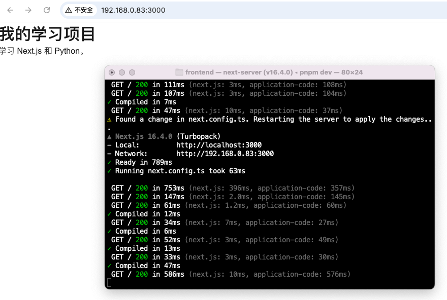
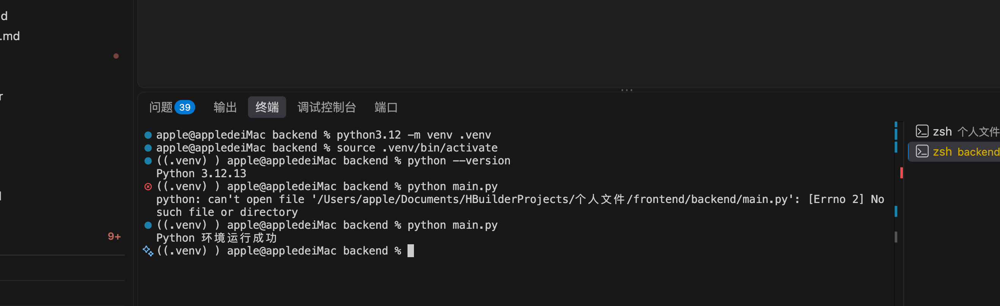

# 第一天学习笔记

排期日期：2026-10-14。

实际学习日期：2026-10-14。

实际完成日期：2026-10-14。

## 1. 完成情况

| 任务 | 状态 | 结果 |
| --- | --- | --- |
| 创建并启动 Next.js 项目 | 已完成 | 首页可访问，页面显示修改后的文字 |
| 处理保存后页面未自动更新的问题 | 已完成 | 配置调整后正常编译，已确认问题解决 |
| 创建 Python 虚拟环境 | 已完成 | 激活后显示 Python 3.12.13 |
| 运行 Python 脚本 | 已完成 | 输出“Python 环境运行成功” |

实际项目目录：`/Users/apple/Documents/HBuilderProjects/个人文件/frontend`。

当前后端目录：项目下的 `backend/`。先沿用现有位置。

## 2. Next.js 启动与首页

在 `frontend` 目录执行：

```bash
pnpm dev
```

首页文件：`src/app/page.tsx`。

```tsx
export default function Home() {
  return (
    <main>
      <h1>我的学习项目</h1>
      <p>今天开始学习 Next.js 和 Python。</p>
    </main>
  );
}
```

| 写法 | 含义 |
| --- | --- |
| `Home()` | React 函数组件，名称首字母大写 |
| `return` | 返回要渲染的内容 |
| JSX | 在代码中描述页面结构，写法类似 HTML |
| `.tsx` | 支持 TypeScript 和 JSX 的文件 |
| `export default` | 导出组件，Next.js 将其作为页面渲染 |

## 3. 页面自动更新问题

**现象：** 保存文件后终端显示 `Compiled`，但浏览器没有自动更新。通过 `192.168.0.83:3000` 访问时，日志提示开发资源的跨来源请求被拦截。

**处理：** 在 `next.config.ts` 的现有配置对象中添加：

```ts
allowedDevOrigins: ["192.168.0.83"],
```

保留其他配置，重启开发服务，浏览器刷新一次，再修改文字验证自动更新。

**记住：** `Compiled` 表示编译完成，`GET / 200` 表示页面请求成功；配置中的地址只填写主机名或 IP，不带协议和端口。

以下截图显示首页、配置变更后的重启和正常编译记录：



## 4. Python 虚拟环境

在 `frontend/backend` 目录执行：

```bash
python3.12 -m venv .venv
source .venv/bin/activate
python --version
```

- `.venv`：当前项目独立的 Python 环境和依赖目录。
- `source`：在当前终端激活环境；新开终端后需要重新激活。
- 激活后使用 `python`，本次版本为 `3.12.13`。
- `deactivate`：退出虚拟环境。

## 5. 第一个 Python 脚本

`main.py` 放在 `backend/` 下，与 `.venv/` 同级：

```text
backend/
├── .venv/
└── main.py
```

```python
def main():
    print("Python 环境运行成功")


if __name__ == "__main__":
    main()
```

- `def`：定义函数。
- `print()`：在终端输出内容。
- `if __name__ == "__main__"`：直接运行文件时调用 `main()`。
- Python 用缩进表示代码层级，本例使用 4 个空格。

运行：

```bash
python main.py
```

**遇到的问题：** 最初出现 `No such file or directory`，表示 Python 找不到当前目录下的 `main.py`。

**解决：** 在 `backend/` 下创建并保存 `main.py`，再次运行，成功输出“Python 环境运行成功”。



## 6. 今日复盘

- 前端通过 `pnpm dev` 启动；保存页面文件后通常会自动更新。
- 运行 Python 前确认所在目录、脚本文件和虚拟环境。
- 报错先看具体信息：编译、访问地址和文件路径分别对应不同问题。
- 下一步：学习 Next.js 客户端组件及页面交互，手动编写旅行需求表单。
