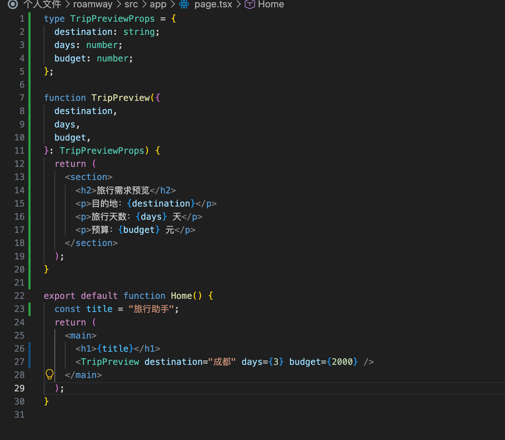

# 第二天学习笔记

日期：2026-10-15。

今天学习 JSX 和 Props，通过旅行需求预览组件练习变量展示、类型声明和父子组件传参。State 和旅行需求表单待继续完成。

## 1. 完成情况

| 任务 | 状态 | 结果 |
| --- | --- | --- |
| 使用 JSX 显示变量 | 已完成 | 定义 `title`，通过 `{title}` 显示“旅行助手” |
| 编写旅行需求预览组件 | 已完成 | 创建 `TripPreview`，展示目的地、天数和预算 |
| 声明 Props 类型并传参 | 已完成 | 使用 `TripPreviewProps`，由 `Home` 传入成都、3 天、2000 元 |
| 添加第二份不同的旅行预览 | 待练习 | 练习同一组件接收不同数据 |
| 学习 State | 待学习 | 理解状态更新如何触发页面更新 |
| 编写旅行需求表单 | 待完成 | 输入目的地、天数和预算，并同步展示预览 |

当前项目目录：`/Users/apple/Documents/HBuilderProjects/个人文件/roamway`。

页面文件：`src/app/page.tsx`。昨天笔记中的项目目录名为 `frontend`，后续按当前 `roamway` 目录继续。

## 2. JSX 与变量展示

React 函数组件返回 JSX，用来描述页面结构。JSX 中使用 `{}` 插入 JavaScript 表达式：

```tsx
const title = "旅行助手";

return <h1>{title}</h1>;
```

- `<h1>旅行助手</h1>`：直接显示固定文字。
- `<h1>{title}</h1>`：显示变量 `title` 的值。
- `{}` 中还可以写表达式，例如 `{days + 1}`，不能直接放 `if` 等语句。
- 自定义 React 组件名称以大写字母开头，例如 `Home`、`TripPreview`。

## 3. Props 类型与参数解构

Props 是父组件传给子组件的数据。本次父组件是 `Home`，子组件是 `TripPreview`。

```tsx
type TripPreviewProps = {
  destination: string;
  days: number;
  budget: number;
};
```

| 属性 | 类型 | 含义 |
| --- | --- | --- |
| `destination` | `string` | 目的地，例如“成都” |
| `days` | `number` | 旅行天数，例如 `3` |
| `budget` | `number` | 预算金额，例如 `2000` |

`type` 声明的是 TypeScript 类型，用于检查代码中的传参，不会自动校验用户输入。

```tsx
function TripPreview({ destination, days, budget }: TripPreviewProps) {
  // 使用取出的三个属性渲染页面。
}
```

这里的 `{ destination, days, budget }` 是对象解构，把 Props 对象中的属性取出来；`: TripPreviewProps` 指定这个参数对象的类型。

注意：参数中的 `{}` 表示解构，JSX 中的 `{}` 表示插入表达式，作用不同。

## 4. 当前完整代码

```tsx
type TripPreviewProps = {
  destination: string;
  days: number;
  budget: number;
};

function TripPreview({
  destination,
  days,
  budget,
}: TripPreviewProps) {
  return (
    <section>
      <h2>旅行需求预览</h2>
      <p>目的地：{destination}</p>
      <p>旅行天数：{days} 天</p>
      <p>预算：{budget} 元</p>
    </section>
  );
}

export default function Home() {
  const title = "旅行助手";
  return (
    <main>
      <h1>{title}</h1>
      <TripPreview destination="成都" days={3} budget={2000} />
    </main>
  );
}
```

数据流：`Home` 传入旅行条件 → `TripPreview` 接收 Props → JSX 展示各属性。



## 5. 字符串与数字的传参区别

```tsx
<TripPreview destination="成都" days={3} budget={2000} />
```

- `destination="成都"` 传入字符串，也可以写成 `destination={"成都"}`。
- `days={3}` 传入数字。
- `days="3"` 传入字符串，不符合这里的 `number` 类型要求。

Props 应当作为只读数据使用。子组件负责读取和展示，后续需要修改数据时，在父组件中通过 State 管理，再把新的值传给子组件。

## 6. 组件复用练习

在 `Home` 的 `<main>` 内添加第二个组件调用，观察同一组件如何展示不同数据：

```tsx
<TripPreview destination="成都" days={3} budget={2000} />
<TripPreview destination="杭州" days={5} budget={3500} />
```

预期页面显示两份旅行需求预览。当前保存的代码和截图仅包含成都这一份，此练习待完成。

## 7. 今日复盘与下一步

- JSX 使用 `{变量或表达式}` 展示动态内容。
- Props 把数据从父组件传给子组件，同一个组件可以通过不同 Props 展示不同内容。
- TypeScript 类型帮助发现错误传参；表单输入仍需单独校验。
- 普通变量不负责触发 React 页面更新；接下来学习 `useState` 管理交互状态。
- 下一步：先让目的地输入框控制预览，再加入天数和预算输入。必填和非法值校验按 10 月 16 日的排期继续。

继续学习时，在项目目录执行 `pnpm dev`，打开首页查看结果。
