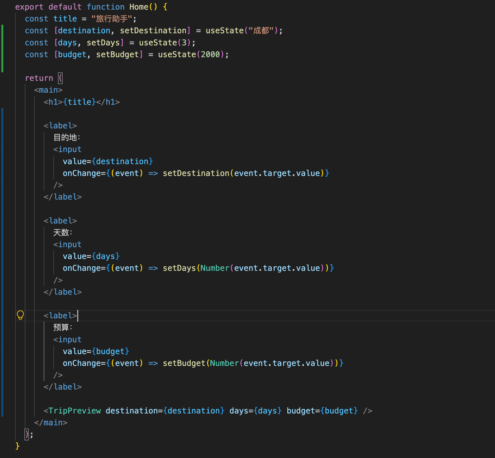
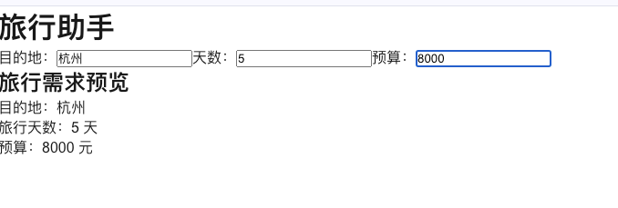

# 第二天学习笔记

排期日期：2026-10-15。

实际学习日期：2026-10-15。

实际完成日期：2026-10-15。

今天学习 JSX、Props 和 State，完成目的地输入与旅行需求预览同步，并补齐天数、预算输入代码。已理解客户端组件声明、数组解构和受控输入；三个字段的输入同步已验证。今日任务状态按用户确认统一标记为已完成。

## 1. 完成情况

| 任务 | 状态 | 结果 |
| --- | --- | --- |
| 使用 JSX 显示变量 | 已完成 | 定义 `title`，通过 `{title}` 显示“旅行助手” |
| 编写旅行需求预览组件 | 已完成 | 创建 `TripPreview`，展示目的地、天数和预算 |
| 声明 Props 类型并传参 | 已完成 | 使用 `TripPreviewProps`，由 `Home` 传入成都、3 天、2000 元 |
| 添加第二份不同的旅行预览 | 已完成 | 用户确认完成组件复用练习 |
| 学习 State | 已完成 | 使用 `useState` 管理目的地，理解状态值与更新函数 |
| 目的地受控输入 | 已完成 | 页面输入“杭州”，预览同步显示“杭州” |
| 天数、预算受控输入 | 已完成 | 天数输入 5、预算输入 8000，预览同步显示 |
| 输入校验 | 已完成 | 按用户确认记录完成状态；下文代码保留基础输入阶段的示例 |

当前项目目录：`/Users/apple/Documents/HBuilderProjects/个人文件/roamway`。

页面文件：`src/app/page.tsx`。昨天笔记中的项目目录名为 `frontend`，后续按当前 `roamway` 目录继续。

## 2. JSX 与变量展示

React 函数组件返回 JSX，用来描述页面结构。JSX 中使用 `{}` 插入 JavaScript 表达式：

```tsx
const title = "旅行助手";

return <h1>{title}</h1>;
```

- `<h1>旅行助手</h1>`：直接显示固定文字。
- `<h1>{title}</h1>`：显示变量 `title` 的值。
- `{}` 中还可以写表达式，例如 `{days + 1}`，不能直接放 `if` 等语句。
- 自定义 React 组件名称以大写字母开头，例如 `Home`、`TripPreview`。

## 3. Props 类型与参数解构

Props 是父组件传给子组件的数据。本次父组件是 `Home`，子组件是 `TripPreview`。

```tsx
type TripPreviewProps = {
  destination: string;
  days: number;
  budget: number;
};
```

| 属性 | 类型 | 含义 |
| --- | --- | --- |
| `destination` | `string` | 目的地，例如“成都” |
| `days` | `number` | 旅行天数，例如 `3` |
| `budget` | `number` | 预算金额，例如 `2000` |

`type` 声明的是 TypeScript 类型，用于检查代码中的传参，不会自动校验用户输入。

```tsx
function TripPreview({ destination, days, budget }: TripPreviewProps) {
  // 使用取出的三个属性渲染页面。
}
```

这里的 `{ destination, days, budget }` 是对象解构，把 Props 对象中的属性取出来；`: TripPreviewProps` 指定这个参数对象的类型。

注意：参数中的 `{}` 表示解构，JSX 中的 `{}` 表示插入表达式，作用不同。

## 4. 当前完整代码

```tsx
"use client";

import { useState } from "react";

type TripPreviewProps = {
  destination: string;
  days: number;
  budget: number;
};

function TripPreview({
  destination,
  days,
  budget,
}: TripPreviewProps) {
  return (
    <section>
      <h2>旅行需求预览</h2>
      <p>目的地：{destination}</p>
      <p>旅行天数：{days} 天</p>
      <p>预算：{budget} 元</p>
    </section>
  );
}

export default function Home() {
  const title = "旅行助手";
  const [destination, setDestination] = useState("成都");
  const [days, setDays] = useState(3);
  const [budget, setBudget] = useState(2000);

  return (
    <main>
      <h1>{title}</h1>

      <label>
        目的地：
        <input
          value={destination}
          onChange={(event) => setDestination(event.target.value)}
        />
      </label>

      <label>
        天数：
        <input
          value={days}
          onChange={(event) => setDays(Number(event.target.value))}
        />
      </label>

      <label>
        预算：
        <input
          value={budget}
          onChange={(event) => setBudget(Number(event.target.value))}
        />
      </label>

      <TripPreview destination={destination} days={days} budget={budget} />
    </main>
  );
}
```

数据流：输入目的地 → 更新 `Home` 的 State → 通过 Props 传给 `TripPreview` → 更新预览。

以下截图记录了从固定 Props 到输入同步的练习过程：






## 5. 字符串与数字的传参区别

```tsx
<TripPreview destination="成都" days={3} budget={2000} />
```

- `destination="成都"` 传入字符串，也可以写成 `destination={"成都"}`。
- `days={3}` 传入数字。
- `days="3"` 传入字符串，不符合这里的 `number` 类型要求。

Props 应当作为只读数据使用。子组件负责读取和展示，后续需要修改数据时，在父组件中通过 State 管理，再把新的值传给子组件。

## 6. 组件复用练习

在 `Home` 的 `<main>` 内添加第二个组件调用，观察同一组件如何展示不同数据：

```tsx
<TripPreview destination="成都" days={3} budget={2000} />
<TripPreview destination="杭州" days={5} budget={3500} />
```

预期页面显示两份旅行需求预览。此练习已按用户确认标记为完成；当前保留的页面代码使用一份预览。

## 7. 为什么添加 "use client"

Next.js App Router 中，组件默认是服务端组件。当前 `Home` 使用了 `useState` 和 `onChange`，需要在文件顶部、所有 `import` 前添加客户端组件声明：

```tsx
"use client";

import { useState } from "react";
```

客户端组件可以使用状态和事件处理交互。这个声明建立客户端入口，其导入的组件也会进入客户端组件树，不需要每个子组件都重复声明。

客户端组件首次访问时仍可在服务端预渲染 HTML；这条声明不代表页面只在浏览器渲染。

## 8. useState 与数组解构

```tsx
const [destination, setDestination] = useState("成都");
```

`useState` 返回一个包含两个元素的数组，分别是当前状态值和更新状态的函数。上面的写法使用数组解构，按位置取出它们：

```tsx
const result = useState("成都");
const destination = result[0];
const setDestination = result[1];
```

- `destination`：本次渲染的状态值，初始为“成都”。
- `setDestination`：请求更新状态并触发重新渲染的函数。
- `"成都"`：初始状态值；组件重新渲染时不会因此把状态重置为“成都”。

调用 `setDestination("杭州")` 后，React 在下一次渲染中提供新状态值。当前执行中的变量不会立即变成新值。

不要直接给 `destination` 赋值。它由 `const` 声明，而且普通变量赋值不会通知 React 更新页面。

## 9. 受控输入与实时预览

```tsx
<input
  value={destination}
  onChange={(event) => setDestination(event.target.value)}
/>
```

- `value` 让输入框显示 React 中的状态值。
- `onChange` 接收输入变化事件。
- `event.target.value` 获取输入框中的新字符串。
- `setDestination` 更新状态，使输入框和预览显示相同的目的地。

这种由 React 状态控制输入值的方式称为受控输入。`Home` 保存状态，`TripPreview` 通过 Props 接收数据并展示。

已确认的页面结果：目的地输入“杭州”、天数输入 `5`、预算输入 `8000`，预览同步显示“杭州、5 天、8000 元”。三个字段的输入同步已完成并验证。

## 10. 天数与预算输入的实际写法

当前实现采用数字状态：

```tsx
const [days, setDays] = useState(3);
const [budget, setBudget] = useState(2000);
```

在输入事件中转换类型，再保存到状态：

```tsx
onChange={(event) => setDays(Number(event.target.value))}
onChange={(event) => setBudget(Number(event.target.value))}
```

`event.target.value` 是字符串，`Number()` 将其转换为数字，预览组件可以直接接收 `days={days}` 和 `budget={budget}`。

当前输入框未指定 `type="number"`。即使后续指定了该类型，读取的 `value` 仍是字符串，而且转换不能代替校验：

- `Number("")` 得到 `0`，清空输入框会被转成零。
- 非数字文本可能转换为 `NaN`。
- 负数、小数等值需要根据业务规则判断是否合法。

此前练习建议使用字符串状态，在展示或提交时再转换，便于保留空输入。本节保留的基础代码选择在输入时直接转换为数字；处理输入边界时需要结合实际输入体验。

手动验证清单：

- [x] 目的地输入“杭州”，预览同步显示“杭州”。
- [x] 天数修改为 `5`，预览显示 `5` 天。
- [x] 预算修改为 `8000`，预览显示 `8000` 元。
- [x] 检查清空、非数字、负数和小数输入，并补充合适提示（按用户确认记录）。

## 11. 今日复盘与后续安排

- JSX 使用 `{变量或表达式}` 展示内容；Props 将数据从父组件传给子组件。
- Props 参数使用对象解构；`useState` 的返回值使用数组解构。
- State 保存交互状态，更新函数通知 React 重新渲染。
- 已完成目的地输入与预览同步，天数和预算输入也已完成并验证。
- 10 月 15 日记录中的任务状态已按用户确认统一标记为已完成；后续日期继续按排期推进。
- 第三方组件库可以在基础表单练习后再接入，目前未安装组件库。

继续学习时，在项目目录执行 `pnpm dev`，打开首页查看结果。
