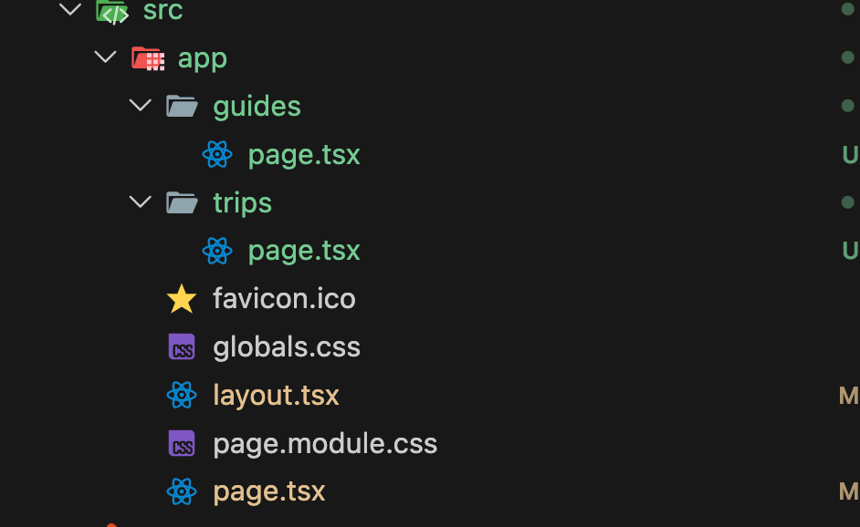
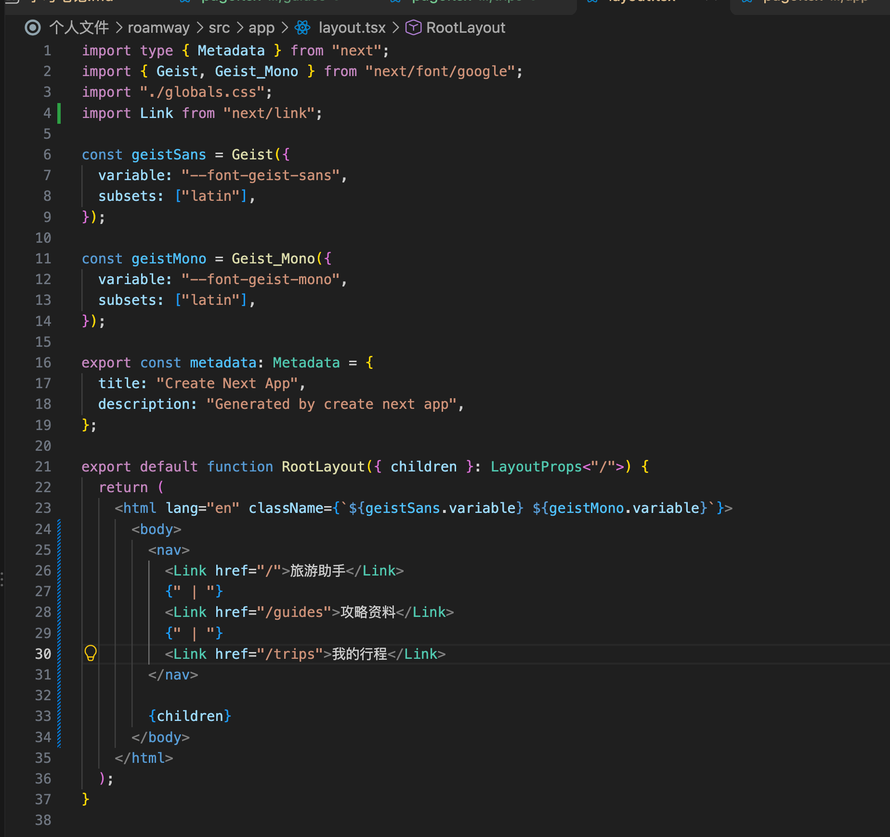
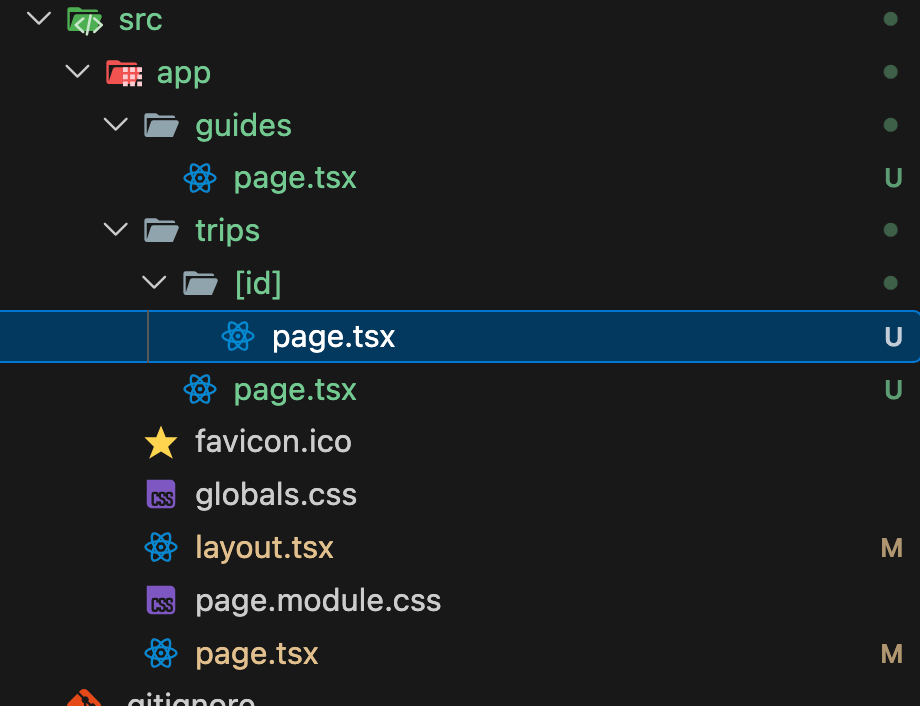
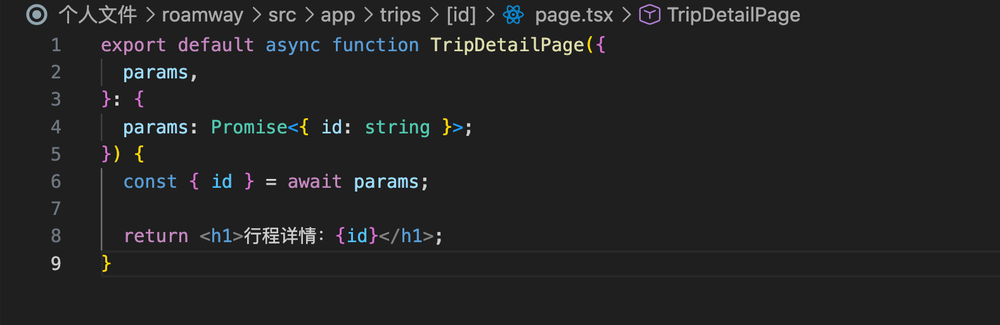
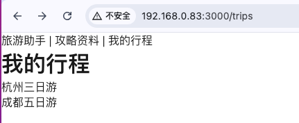
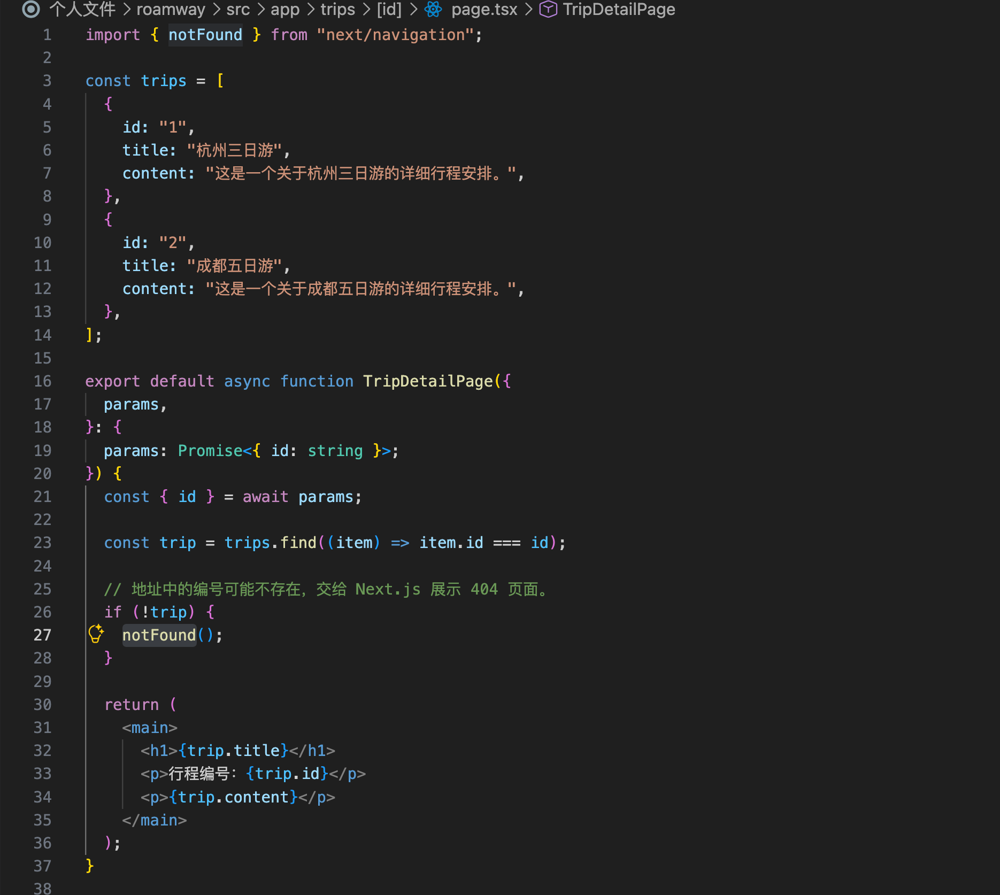
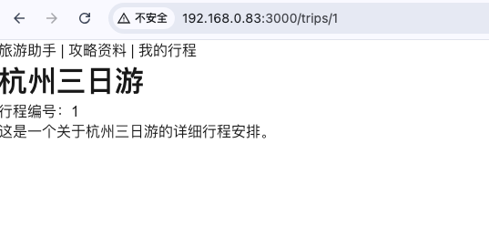

# 路由与布局

排期日期：2026-10-17。

实际学习日期：2026-10-15。

实际完成日期：2026-10-15。

主题：Next.js 路由和布局。状态：已完成（三个页面、公共导航、动态路由及列表与详情展示已实现，404 页面已由用户人工验证）。

## 1. 学习目标与完成情况

- [x] 创建旅游助手、攻略资料、我的行程三个页面。
- [x] 使用 `Link` 切换三个页面。
- [x] 通过根布局 `layout.tsx` 共享导航。
- [x] 修复布局文件缺少组件函数和根标签的问题。
- [x] 创建动态路由，通过 `params` 读取行程编号。
- [x] 学习 `"use client"` 的文件声明与模块边界。
- [x] 使用 `map()` 渲染行程列表，通过 `Link` 连接详情页。
- [x] 使用 `find()` 按编号查找行程，展示名称、编号和说明。
- [x] 查找不到行程时调用 `notFound()`，404 页面已人工验证。

## 2. 文件系统路由

Next.js App Router 根据目录和约定文件定义路由，不需要像 Vue Router 那样手写路由表。

| 页面文件 | 访问路径 | 页面 |
| --- | --- | --- |
| `src/app/page.tsx` | `/` | 旅游助手 |
| `src/app/guides/page.tsx` | `/guides` | 攻略资料 |
| `src/app/trips/page.tsx` | `/trips` | 我的行程 |

文件夹定义路径片段，`page.tsx` 定义该路径的页面。只有文件夹、没有页面文件时，不会生成可直接访问的页面。

页面需要默认导出 React 组件，组件名可以自定义，`page.tsx` 文件名遵守框架约定：

```tsx
export default function GuidesPage() {
  return <h1>攻略资料</h1>;
}
```

纯展示页面无需添加 `"use client"`。首页包含状态和输入交互，保留现有的 `"use client"`。

实际创建后的路由目录：



## 3. Link 与公共布局

`Link` 从 `next/link` 导入，通过 `href` 指定目标路径，作用类似 Vue 的 `RouterLink`：

```tsx
import Link from "next/link";

<Link href="/guides">攻略资料</Link>
```

根布局 `src/app/layout.tsx` 包裹其下的页面，因此公共导航可以放在这里。以下是便于理解的结构示例；实际文件继续保留字体、全局样式和 metadata 等配置：

```tsx
import Link from "next/link";

export default function RootLayout({ children }: LayoutProps<"/">) {
  return (
    <html lang="zh-CN">
      <body>
        <nav>
          <Link href="/">旅游助手</Link>
          {" | "}
          <Link href="/guides">攻略资料</Link>
          {" | "}
          <Link href="/trips">我的行程</Link>
        </nav>
        {children}
      </body>
    </html>
  );
}
```

`children` 是 Next.js 传入的当前页面或下级布局，在 JSX 中通过 `{children}` 展示。可类比 Vue 中路由内容的展示位置，但不需要自己创建 `RouterView`。

访问 `/guides` 时，公共导航保持显示，`children` 对应攻略资料页；访问 `/trips` 时，对应我的行程页。

实际布局代码：



导航与攻略资料页展示效果：


## 4. 本次报错与修复

添加导航时，误把整个 `layout.tsx` 替换成了单独的 `<body>` 片段，导致：

- 缺少默认导出的布局组件函数。
- `children` 未通过函数参数接收，成为未定义变量。
- 缺少根布局要求的 `<html>` 标签。

修复方式：恢复完整 `RootLayout` 函数和 `<html>`、`<body>` 结构，把导航放进函数返回的 JSX 中；保留原有字体、样式和 metadata 配置。

以后替换代码片段时，先确认替换范围：修改 `<body>` 内部内容时，不删除外层组件函数。

## 5. 动态路由与异步 params

创建 `src/app/trips/[id]/page.tsx`，方括号是文件夹名称的一部分。`[id]` 表示该路径片段可以变化，同一个页面文件可以匹配不同的行程编号：

| 页面文件 | 访问路径示例 | 参数 |
| --- | --- | --- |
| `src/app/trips/page.tsx` | `/trips` | 无动态参数 |
| `src/app/trips/[id]/page.tsx` | `/trips/1` | `id` 为字符串 `"1"` |
| `src/app/trips/[id]/page.tsx` | `/trips/2` | `id` 为字符串 `"2"` |



初次练习代码（后续已扩展为查找并展示行程，见第 8 节）：

```tsx
export default async function TripDetailPage({
  params,
}: {
  params: Promise<{ id: string }>;
}) {
  const { id } = await params;

  return <h1>行程详情：{id}</h1>;
}
```

- `params` 由 Next.js 传入，属性名 `id` 对应文件夹名 `[id]`。
- 当前版本的 `params` 是 Promise，使用 `await params` 读取，因此页面函数声明为 `async`。
- 即使地址中的编号是数字，读取到的 `id` 也是字符串。
- 该页面在服务端读取参数并渲染，不需要 `"use client"`。
- 初次练习仅展示路径编号；后续已接入本地示例数组，尚未连接后端或数据库。



初次练习截图显示访问 `/trips/1` 后，页面正确展示“行程详情：1”，并继续显示根布局中的公共导航：


## 6. use client 的作用范围

`"use client"` 写在需要建立客户端边界的文件顶部、所有 import 之前：

```tsx
"use client";

import { useState } from "react";
```

它按文件声明，并影响该文件导入的客户端模块依赖，不按文件夹层级传播：

- 首页 `app/page.tsx` 添加后，不会让旁边的 `trips/page.tsx` 自动变成客户端组件。
- 已处于客户端模块依赖范围内的子组件，不需要重复添加。
- 通过 `children` 等 Props 传入的服务端内容，不会仅因为外层是客户端组件就自动变成客户端模块。
- 使用 State、点击或输入事件、浏览器 API 的交互组件通常需要客户端边界。
- 单纯使用 `Link`，无需把整个页面或布局标为客户端组件。

| 当前文件 | 是否需要声明 | 原因 |
| --- | --- | --- |
| `app/page.tsx` | 需要 | 首页表单使用 State 和输入事件 |
| `app/layout.tsx` | 不需要 | 展示公共导航与页面内容 |
| `app/guides/page.tsx` | 不需要 | 纯展示 |
| `app/trips/page.tsx` | 不需要 | 渲染固定行程列表，使用 Link 导航 |
| `app/trips/[id]/page.tsx` | 不需要 | 服务端读取参数、查找并展示行程 |

## 7. 行程列表与详情链接

在 `src/app/trips/page.tsx` 中定义两条示例行程，通过 `map()` 渲染列表：

```tsx
import Link from "next/link";

const trips = [
  { id: "1", title: "杭州三日游" },
  { id: "2", title: "成都五日游" },
];

export default function TripsPage() {
  return (
    <main>
      <h1>我的行程</h1>
      <ul>
        {trips.map((trip) => (
          <li key={trip.id}>
            <Link href={`/trips/${trip.id}`}>
              {trip.title}
            </Link>
          </li>
        ))}
      </ul>
    </main>
  );
}
```

- 列表中的详情链接按编号指向 `/trips/1`、`/trips/2`。
- 当前数据是固定数组，使用 `Link` 本身不要求添加 `"use client"`。



## 8. 根据编号查找和展示详情

详情页不再只显示编号，而是使用 `find()` 从本地示例数组查找对应行程。当前数据包含 `id`、`title` 和 `content` 三个字段。

核心代码（位于 `TripDetailPage` 内，`trips` 为页面顶部定义的数组）：

```tsx
const { id } = await params;
const trip = trips.find((item) => item.id === id);

// 不存在的编号交给 Next.js 展示 404 页面。
if (!trip) {
  notFound();
}

return (
  <main>
    <h1>{trip.title}</h1>
    <p>行程编号：{trip.id}</p>
    <p>{trip.content}</p>
  </main>
);
```

`find()` 返回第一条符合条件的数据；找不到则返回 `undefined`。访问 `/trips/1` 时，路径参数 `id` 为 `"1"`，因此找到杭州三日游并展示名称、编号和详细说明。





## 9. notFound 与 404 页面

`notFound()` 从 `next/navigation` 导入，用于当前请求的行程不存在时展示 404 界面：

```tsx
import { notFound } from "next/navigation";

if (!trip) {
  notFound();
}
```

调用后会中断当前路由片段的渲染，不再执行后面的详情展示代码，无需写 `return notFound()`。TypeScript 也能识别这个分支会中断执行，因此后续可以直接使用 `trip.title`。

要区分函数和界面文件：

| 名称 | 作用 | 当前状态 |
| --- | --- | --- |
| `notFound()` | 触发内容不存在的处理 | 已使用 |
| `not-found.tsx` | 自定义 404 界面 | 已讲解，当前未创建 |

当前使用 Next.js 默认的 404 界面，用户已确认人工验证通过；本次没有新增 404 截图，不影响人工验证结果的记录。

## 10. 验证记录

- 布局修复后曾运行 `pnpm exec tsc --noEmit --incremental false`，通过；该结果只对应当时的代码。
- 截图7展示 `/trips` 的行程列表，源码已包含两个详情链接。
- 截图8展示详情页的查找和不存在处理逻辑；截图9展示 `/trips/1` 的名称、编号和说明。
- 404 页面已由用户人工验证通过。
- 本次整理核对了页面源码、截图内容、PNG 格式和文档链接；未重新运行类型检查或构建。

## 11. 后续安排

本次路由和布局学习已完成，按排期继续学习 Python 函数、列表和字典。

前置内容见[表单校验](../10.16/笔记（表单校验）.md)。
