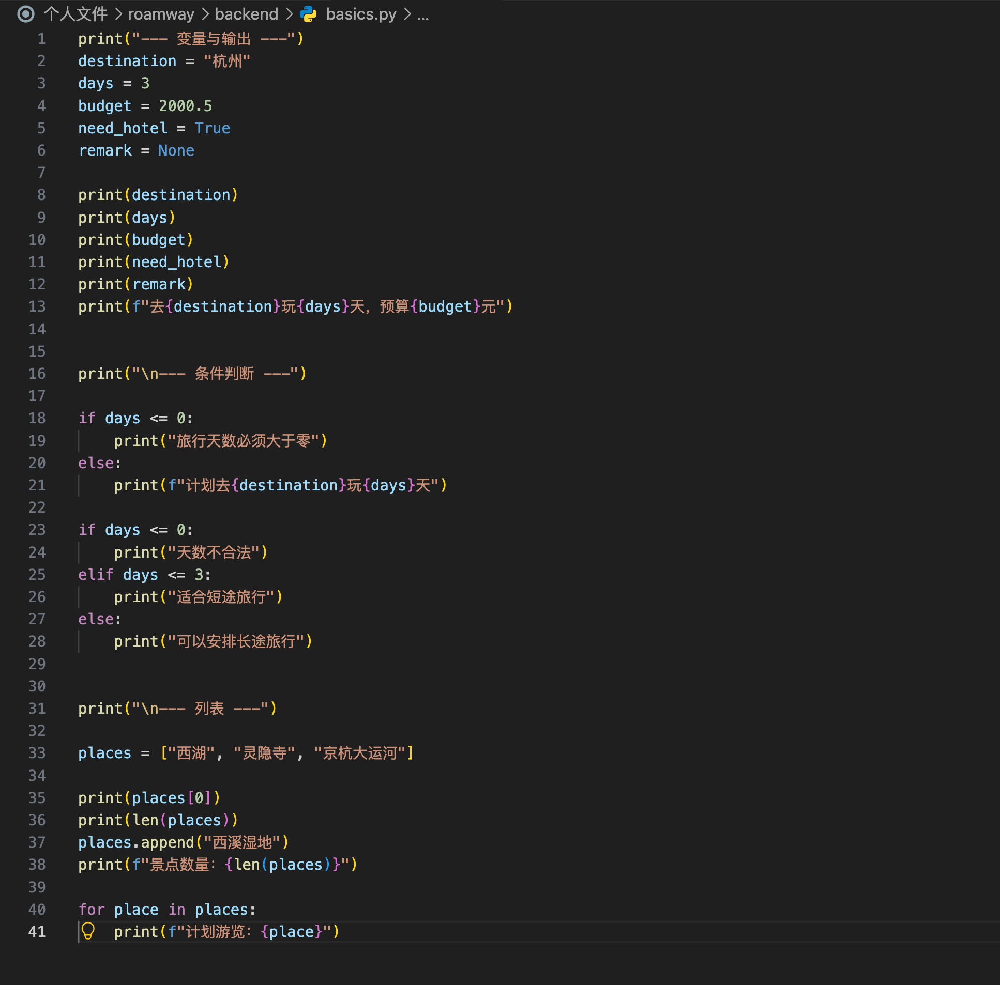
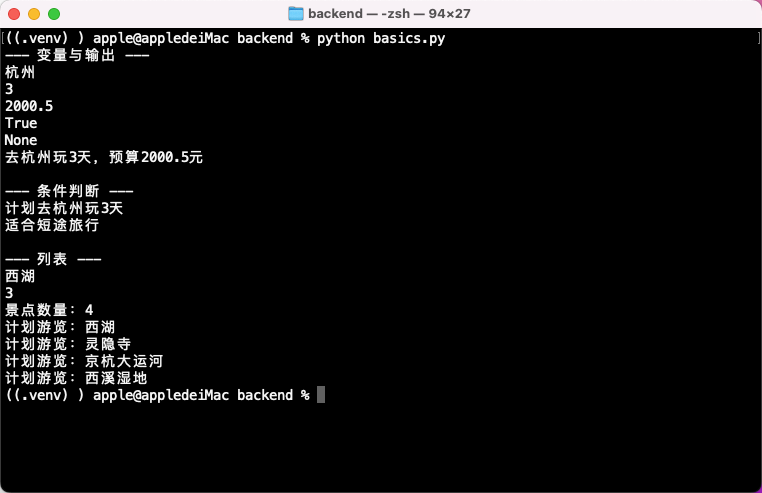
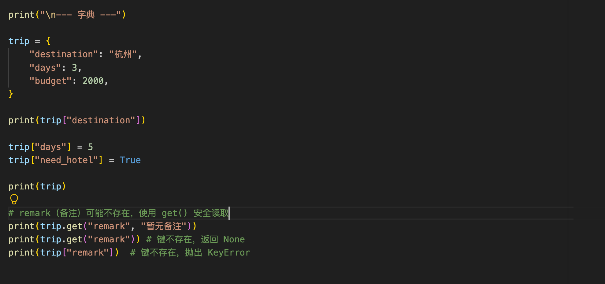
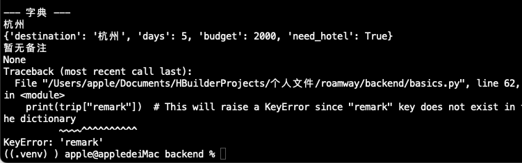
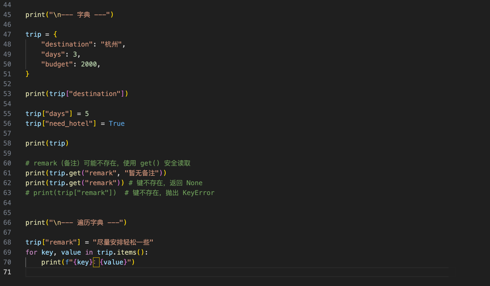
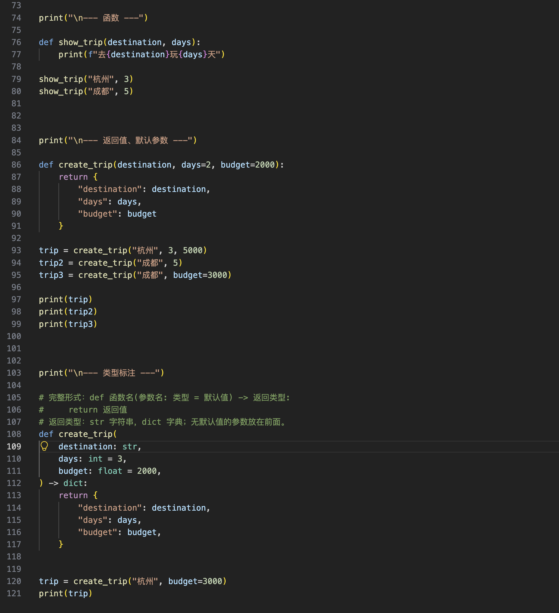
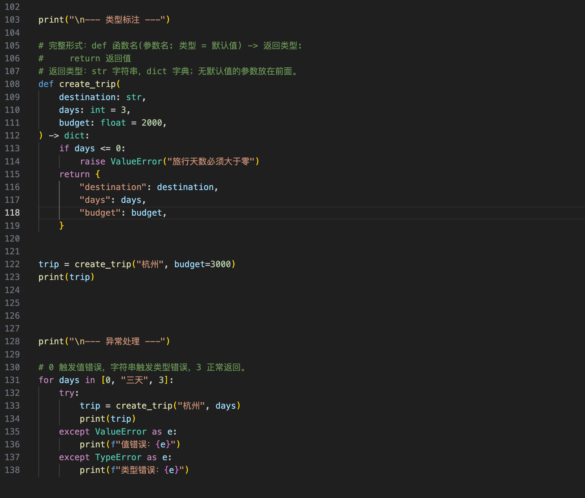

# 第五天学习笔记

排期日期：2026-10-18。

实际学习日期：2026-10-15。

实际完成日期：未完成。

主题：Python 零基础入门。状态：进行中，基础语法、函数、返回值、默认参数及类型标注已有代码与运行记录，异常处理已运行验证，模块导入待学习。

练习文件：`backend/basics.py`。本次先补 Python 语法基础，再继续函数课程。

## 1. 当前进度

- [x] 变量、基础类型、输出与字符串插值。
- [x] 条件判断与缩进。
- [x] 列表读取、添加和循环。
- [x] 字典读取、修改和新增字段。
- [x] 理解缺失键、get() 与 KeyError。
- [x] 使用 items() 遍历字典。
- [x] 定义并调用函数，使用 return 返回字典。
- [x] 设置默认参数，使用位置参数和关键字参数调用。
- [x] 添加参数与返回值类型标注，理解标注的作用。
- [x] 练习 raise 与 try / except，验证值错误、类型错误及正常输入。
- [ ] 学习模块导入。

## 2. 变量与输出

```python
destination = "杭州"
days = 3
budget = 2000.5
need_hotel = True
remark = None

print(destination)
print(f"去{destination}玩{days}天，预算{budget}元")
```

| 写法 | 含义 |
| --- | --- |
| `"杭州"` | 字符串 str |
| `3` | 整数 int |
| `2000.5` | 浮点数 float |
| `True`、`False` | 布尔值，首字母大写 |
| `None` | 没有值 |
| `print()` | 输出到控制台 |
| `f"...{变量}..."` | 字符串插值 |

变量不用写 let、const，行尾通常不加分号。控制台使用简短标题分块，例如 `print("\n--- 列表 ---")`。

## 3. 条件判断与缩进

```python
if days <= 0:
    print("天数不合法")
elif days <= 3:
    print("适合短途旅行")
else:
    print("可以安排长途旅行")
```

条件后面加冒号，用 4 个空格缩进表示代码块。`elif` 类似 JS 的 else if；取消缩进表示离开当前代码块。

## 4. 列表与循环

```python
places = ["西湖", "灵隐寺", "京杭大运河"]

print(places[0])
print(len(places))
places.append("西溪湿地")
print(f"景点数量：{len(places)}")

for place in places:
    print(f"计划游览：{place}")
```

列表类似 JS 数组：索引从 0 开始，`len()` 读取长度，`append()` 在末尾添加元素，`for ... in ...` 逐个遍历。添加前长度为 3，添加后为 4。

变量、条件判断和列表练习代码：



对应运行结果：



## 5. 字典与缺失字段

```python
trip = {
    "destination": "杭州",
    "days": 3,
    "budget": 2000,
}

print(trip["destination"])
trip["days"] = 5
trip["need_hotel"] = True

# remark（备注）可能不存在
print(trip.get("remark", "暂无备注"))
print(trip.get("remark"))
```

字典保存键值对。读取键使用 `trip["destination"]`，不能写成 JS 对象的点访问形式 `trip.destination`。赋值可以修改已有键，也可以新增键。

| 读取方式 | remark 不存在时 |
| --- | --- |
| `trip.get("remark", "暂无备注")` | 返回“暂无备注” |
| `trip.get("remark")` | 返回 None |
| `trip["remark"]` | 抛出 KeyError |

字典中不存在的键与值为 None 的变量不同：前面定义了 `remark = None`，不会自动给 `trip` 添加同名键。



练习时直接读取 `trip["remark"]`，出现 `KeyError: 'remark'`，程序停止执行：



为继续后面的练习，当前代码已注释这行，保留 get() 的安全读取示例。

## 6. 遍历字典

```python
trip["remark"] = "尽量安排轻松一些"

for key, value in trip.items():
    print(f"{key}：{value}")
```

`items()` 每次提供一个键值对，由 `key`、`value` 分别接收，可类比 JS 的 Object.entries()。新增备注放在循环前，因此遍历结果中也会包含 remark。




## 7. 函数与返回值

```python
def show_trip(destination, days):
    print(f"去{destination}玩{days}天")

show_trip("杭州", 3)
show_trip("成都", 5)
```

`def` 定义函数，参数接收调用时传入的数据。函数体缩进 4 个空格，定义不会执行函数体，调用才会执行。

- `print()` 将内容输出到控制台。
- `return` 将数据交给调用方，并结束本次函数执行。
- 没有显式 return 的函数，执行结束返回 None。

## 8. 默认参数与关键字参数

```python
def create_trip(destination, days=2, budget=2000):
    return {
        "destination": destination,
        "days": days,
        "budget": budget,
    }

trip = create_trip("杭州", 3, 5000)
trip2 = create_trip("成都", 5)
trip3 = create_trip("成都", budget=3000)
```

| 调用 | 天数 | 预算 |
| --- | --- | --- |
| `create_trip("杭州", 3, 5000)` | 3 | 5000 |
| `create_trip("成都", 5)` | 5 | 2000 |
| `create_trip("成都", budget=3000)` | 2（默认） | 3000 |

位置参数按顺序传入；关键字参数按名称指定，可以保留其他参数的默认值。普通参数列表中，无默认值的参数放在有默认值的参数前面。列表、字典等可变对象不要直接作为默认值。

## 9. 类型标注

完整形式已写入代码注释：

```python
# 完整形式：def 函数名(参数名: 类型 = 默认值) -> 返回类型:
#     return 返回值
```

实际练习：

```python
def create_trip(
    destination: str,
    days: int = 3,
    budget: float = 2000,
) -> dict:
    return {
        "destination": destination,
        "days": days,
        "budget": budget,
    }

trip = create_trip("杭州", budget=3000)
print(trip)
```

| 标注 | 含义 |
| --- | --- |
| `str` | 字符串 |
| `int` | 整数 |
| `float` | 浮点数；此处也可以传整数金额 |
| `-> dict` | 返回字典 |
| `-> str` | 返回字符串 |

返回字符串的形式（已讲解，未加入当前脚本）：

```python
def describe_trip(destination: str, days: int = 3) -> str:
    return f"去{destination}玩{days}天"
```

类型标注帮助阅读、编辑器补全和静态类型检查，不会自动执行运行时校验。配置 Pyright、mypy 等工具可以在运行前检查类型；例如 days 为负数时，类型正确但业务值不合法，仍需自行校验。当前未安装或配置新的类型检查工具。

练习代码：



运行结果：


当前脚本为分阶段练习，两次定义了 create_trip。后一次定义会替换后续使用的同名函数：前一版默认 2 天，类型标注版默认 3 天；前面已执行的调用结果不受影响。

## 10. 异常处理

在带类型标注的 create_trip 函数中，return 前加入：

```python
if days <= 0:
    raise ValueError("旅行天数必须大于零")
```

调用方分别捕获值错误和类型错误：

```python
for days in [0, "三天", 3]:
    try:
        trip = create_trip("杭州", days)
        print(trip)
    except ValueError as e:
        print(f"值错误：{e}")
    except TypeError as e:
        print(f"类型错误：{e}")
```

### except ValueError as e 的含义

- `except`：捕获 try 中发生的异常。
- `ValueError`：只匹配这一类异常。
- `as e`：用变量 e 接收异常对象，也可以命名为 error。

`print(e)` 显示异常信息。异常被捕获并提示后，循环还能继续处理下一项。

### 两类异常从哪里来

| 输入 | 执行过程 | 结果 |
| --- | --- | --- |
| `0` | days <= 0 成立，执行 raise | 主动抛出 ValueError |
| `"三天"` | 尝试计算 `"三天" <= 0` | Python 自动抛出 TypeError |
| `3` | 比较正常、条件不成立 | 返回行程字典 |

`ValueError` 表示值不合适；`TypeError` 表示类型或操作组合不合适。它们都是 Python 内置异常类别，既可以由 Python 自动抛出，也可以用 raise 主动抛出。本次值错误由代码主动抛出，类型错误由比较操作自动触发。

### 类型标注不会主动抛错

```python
def show_days(days: int):
    print(days)

show_days("三天")  # 正常输出，标注本身不校验类型
```

只有执行不支持的操作，或主动校验并 raise，运行时才会报错。本次 TypeError 来自字符串与整数的大小比较，不是 days: int 标注检查出来的。

标注负责说明预期类型，静态检查工具可以提前提示；运行时校验需要自行编写，或由 FastAPI 等框架提供。

### 常见异常类别

| 类别 | 例子 |
| --- | --- |
| ValueError | `int("杭州")`，值无法转换 |
| TypeError | `"3" + 2`，操作类型不匹配 |
| KeyError | `{}["remark"]`，字典缺少键 |
| IndexError | `[][0]`，列表索引越界 |
| NameError | 使用未定义的变量 |
| ZeroDivisionError | `10 / 0`，除数为零 |
| FileNotFoundError | 打开不存在的文件 |

也可以使用 `except (ValueError, TypeError) as e:` 合并处理两类异常；当前练习使用两个分支分别提示。




## 11. 验证与下一步

- 异常处理改动后已运行 `python3 backend/basics.py`，正常退出；0、字符串和3三个输入分别触发值错误、类型错误和正常返回，与截图一致。
- 十张截图记录了学习过程；KeyError 截图对应此前刻意读取缺失键的情况。
- 图片 PNG 格式、相对引用和文档编码已检查；本次整理未重复运行脚本、前端构建或静态类型检查工具。
- 下一步：学习将函数放进单独文件并导入使用。

前置内容见[第四天学习笔记](../10.17/学习笔记.md)。
