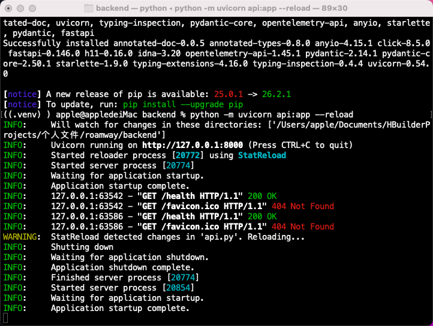
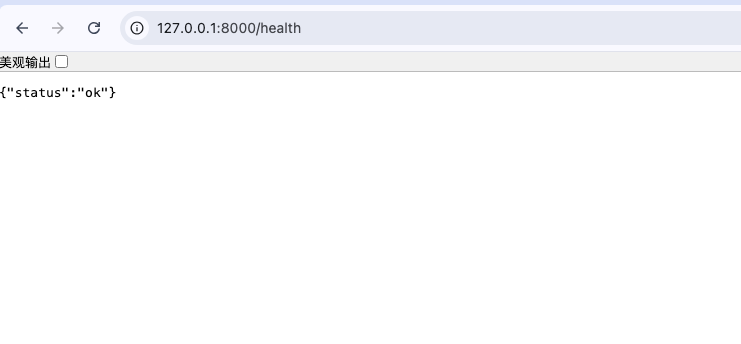
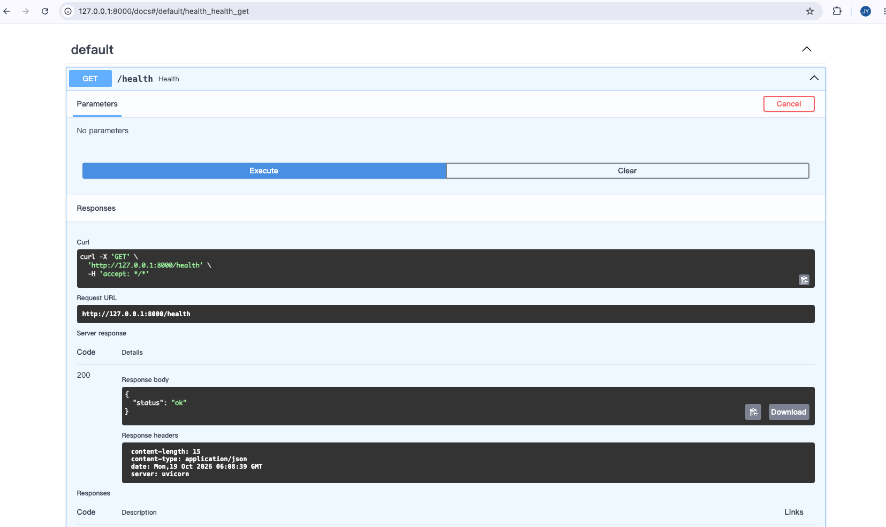

# 接口与请求模型

排期日期：2026-10-20。

实际学习日期：2026-10-19 ～ 2026-10-20。

实际完成日期：未完成。

## 当日学习计划及完成情况

| 状态 | 学习任务 | 完成情况 |
| --- | --- | --- |
| 已完成 | 安装 FastAPI、Uvicorn，启动服务 | 虚拟环境安装成功，服务可运行 |
| 已完成 | 编写健康检查，使用接口文档 | 浏览器与 `/docs` 调用 `/health` 均返回 200 和正确 JSON |
| 已完成 | Pydantic 请求模型与 `model_dump()` | 理解模型校验与字典转换；正常输入、非法天数均已验证 |
| 已完成 | 嵌套模型与每日安排 | 增加标题、每日安排列表；正常输入和空安排内容的失败请求已验证 |
| 已完成 | 跨字段校验 | 安排数量不符、编号不符被拒绝，合法请求通过；用户已确认 |
| 进行中 | 输入清理与完整校验 | 首尾空白清理、拒绝纯空白文本已完成（2026-10-20 用户确认）；天数范围待明确 |
| 已完成 | 响应模型入门 | 用户确认完成，已核对 `api.py` 保存了 `response_model=TripInput`；独立响应模型及行程标识待后续实现 |
| 未开始 | Python 同步/异步 | 接下来学习 `async def`、`await` 与 FastAPI 执行边界 |

## 学习笔记

### 1. 从 Python 函数到 HTTP 接口

在 `backend` 目录操作：

```bash
source .venv/bin/activate
python -m pip install fastapi uvicorn
python -m uvicorn api:app --reload
```

依赖只需首次安装。FastAPI 定义路由，Uvicorn 启动服务；`api:app` 指 `api.py` 中的应用对象，`--reload` 在修改代码后自动重启。

`@app.get("/health")` 注册健康检查，函数返回 `{"status": "ok"}`，框架将字典转成 JSON 响应。



浏览器访问 `http://127.0.0.1:8000/health`，结果正确：



再通过 `/docs` 的 Try it out → Execute 发起请求，确认 Server response 为 200：



过程中遇到 Pylance 找不到 `fastapi`，已核实虚拟环境可以导入；处理方式为 `Python: Select Interpreter` 选择 `backend/.venv/bin/python`，必要时重载窗口。终端激活环境不等于编辑器选中了同一解释器，提示是否消失待确认。日志中 `/favicon.ico` 的 404 只是缺少图标，不影响接口。

### 2. 接收参数并观察校验结果

在 `models.py` 定义 `TripInput(BaseModel)`，使用 `Field` 约束必填、非空、正天数及非负有限预算；`DailyPlan` 表示一天，`daily_plans: list[DailyPlan]` 表示每日安排列表。

在 `api.py` 接收模型：

```python
@app.post("/trips")
def create_trip(trip: TripInput) -> dict:
    # 校验通过才执行；模型转字典后返回 JSON。
    return trip.model_dump()
```

理解要点：`TripInput` 可以类比 TS 类型声明理解结构，但它还会执行运行时校验；`trip` 是模型对象，`model_dump()` 将其转成普通字典，嵌套模型也会一起转换。

通过 `/docs` 提交请求：合法输入返回 200；`days=0`、每日安排的 `morning=""` 返回 422。错误响应 `detail` 中的 `loc` 指出字段位置，`msg` 说明原因；校验失败不进入接口函数。

### 3. 检查旅行天数与安排的关系

在 `TripInput` 中使用 `@model_validator(mode="after")`：字段校验成功后，检查安排数量和编号；成功返回 `self`，失败抛出 `ValueError`，接口返回 422。

关键判断：

```python
if len(self.daily_plans) != self.days:
    raise ValueError("每日安排数量必须与旅行天数一致")

actual_days = [plan.day for plan in self.daily_plans]
expected_days = list(range(1, self.days + 1))

if actual_days != expected_days:
    raise ValueError("每日安排必须按第 1 天到最后一天依次排列")
```

已验证：一日游且 day=1 通过；days=2 但只有一条安排失败；days=1 但 day=333 失败。结果依据用户确认，未新增截图。

列表推导式、`range` 及列表比较的解释统一放在[后端语法基础](../10.18/笔记（后端语法基础）.md#14-补充列表推导式range-与列表比较)。

### 4. 清理空白（2026-10-20）

在 `DailyPlan` 和 `TripInput` 内分别增加配置，保留原有字段上的 `min_length=1`：

```python
from pydantic import ConfigDict

# 写在各模型类内部，配置当前模型的字符串处理方式。
model_config = ConfigDict(str_strip_whitespace=True)
```

`model_config` 是 Pydantic 约定的配置名称；`ConfigDict` 提供配置项类型提示，运行时是普通字典。此项配置清理字符串首尾空白，纯空白清理后成为空字符串，再被最小长度约束拒绝。嵌套的 `DailyPlan` 有自己的配置边界，因此两个模型都需要配置。

用户确认本节验证完成：标题首尾空格被清理，纯空白标题与纯空白 `morning` 返回 422。代码已核对，接口未由助手重新运行。

天数目前只限制大于 0，上限尚未确定；完整输入规则仍未全部完成。

### 5. 响应模型入门（2026-10-20）

本节学习给现有接口声明响应模型：

```python
@app.post("/trips", response_model=TripInput)
def create_trip(trip: TripInput) -> dict:
    return trip.model_dump()
```

参数上的 `trip: TripInput` 约束输入，装饰器中的 `response_model=TripInput` 约束输出。FastAPI 会校验并过滤返回数据，同时在接口文档中描述响应结构。当前返回的数据原本就符合模型，因此合法请求的 JSON 可以保持不变；输出校验失败属于服务端错误，与输入不合法返回 422 不同。

用户确认本节已完成，助手重新核对磁盘中的 `backend/api.py`，已保存 `response_model=TripInput`；未重新运行接口验证。当前暂复用输入模型，保存行程所需的独立响应模型与标识仍未实现。

### 当日新知识点

- **Pydantic 请求模型**：既描述数据结构，也执行运行时校验；FastAPI 校验成功后才调用接口函数。
- **嵌套模型与转换**：列表中的对象也会按子模型校验；`model_dump()` 将模型及其嵌套模型转为普通字典结构。
- **跨字段校验**：`model_validator(mode="after")` 用于检查字段间的关系，通过时返回 `self`，不通过时抛出 `ValueError`。
- **Python 列表语法差异**：本日补学了列表推导式、`range` 和列表内容比较，详细说明归入[后端语法基础](../10.18/笔记（后端语法基础）.md#14-补充列表推导式range-与列表比较)。

当前 POST 接口只校验并返回输入，尚未保存行程或分配编号。后续整体安排见[学习计划](../../学习计划.md)。本次仅整理文档，未重新运行接口或构建。
