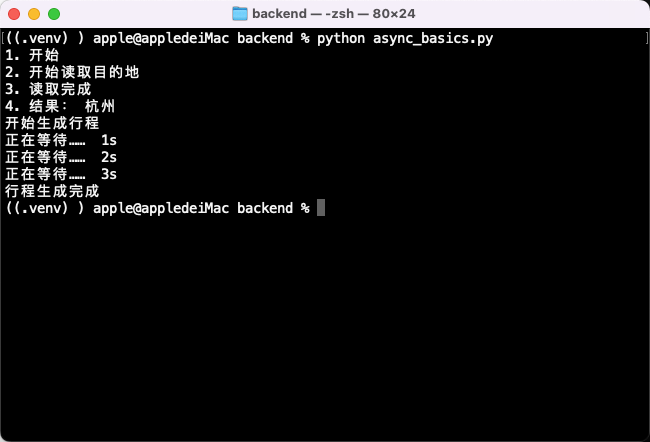

# 同步与异步

排期日期：2026-10-28。

实际学习日期：2026-10-28。

实际完成日期：2026-10-28。

## 当日学习计划及完成情况

每天最多 1.5 小时；本次实际用时未计时，不记录为耗时 1.5 小时。

| 学习任务 | 状态 | 实际完成情况 |
| --- | --- | --- |
| async def、协程与 await | 已完成 | 理解仅调用不执行函数体；用户确认理解 |
| 顺序与并发等待 | 已完成 | 能判断连续两次 await 为顺序等待；运行 gather 进度实验 |
| FastAPI 同步/异步边界 | 已完成（入门） | 学习按客户端能力选择 def / async def；当前行程接口保留 def |
| 观察实验结果 | 已完成 | 用户确认生成完成前能看到逐次等待提示；已补充终端运行截图 |

## 学习笔记

### 1. 本次需要掌握的边界

同步 SDK 指调用后当前线程需等待网络响应的工具包；加上 await 不会改变同步方法的执行方式。

FastAPI 的普通 def 接口由框架放到线程池执行；async def 接口在事件循环中执行，适合调用支持 await 的异步客户端。这个线程池安排不会自动应用到异步接口中直接调用的普通辅助函数。

当前 `backend/api.py` 的 POST /trips 只将模型转成字典，没有网络或数据库等待，保持 def 即可。简单同步计算可直接在异步函数中执行；应避免在事件循环中直接调用阻塞的同步网络请求或 time.sleep。

### 2. Python 语法与 JS 的差异

- `def` 函数调用时执行函数体；`async def` 函数仅调用时返回协程对象，尚未执行函数体。与 JS 的 async 函数调用后立即执行到首次挂起的位置不同。
- 在运行中的协程里，`await` 可以执行并等待另一个协程；当前函数仍需等待结果才能继续。异步等待期间，事件循环可以处理其他已调度任务。
- `await` 不是将同步调用转换为异步调用的开关。`await sync_function()` 会先执行同步函数，依然可能阻塞；普通字典等返回值不能被 await。
- 连续两次 `await` 是顺序等待；`asyncio.gather()` 可以并发调度互不依赖的协程，结果顺序与传入顺序一致，可类比 JS 的 `Promise.all()`。
- 独立脚本使用 `asyncio.run(main())` 启动异步入口；FastAPI 管理接口的异步执行，不在接口内调用 `asyncio.run()`。

```python
async def demo():
    print("进入 demo")
    return "杭州"

async def main():
    print("A")
    job = demo()  # 此时尚未进入 demo 的函数体。
    print("B")
    result = await job
    print("C", result)
```

上述例子的预期顺序为 A、B、进入 demo、C 杭州；此例用于解释调用与执行的区别，未单独记录运行验证。

`for i in range(3)` 的 i 依次为 0、1、2；`_` 是不使用循环值时的惯用命名。需要显示次数时用 `i + 1`，例如 `print(f"正在等待…… {i + 1}s")`；此处的秒数文案是循环计数，不是精确计时。

`asyncio.to_thread()` 只作概念介绍，暂不要求掌握或练习，遇到异步接口必须调用阻塞同步库时再学习。应用练习和实际结果见下文。

### 3. 等待期间打印进度

练习文件：`backend/async_basics.py`。磁盘已保存的并发部分如下：

```python
async def generate_trip():
    print("开始生成行程")
    await asyncio.sleep(4)
    print("行程生成完成")

async def show_progress():
    for i in range(3):
        await asyncio.sleep(1)
        print(f"正在等待……  {i+1}s")

async def main():
    await asyncio.gather(
        generate_trip(),
        show_progress(),
    )

if __name__ == "__main__":
    asyncio.run(main())
```

在 backend 目录运行：

```bash
python async_basics.py
```

generate_trip 等待时，show_progress 仍可执行。当前代码预期在约第 1、2、3 秒打印提示，约第 4 秒完成生成，并发段约 4 秒，不是两项耗时相加。

文件前半段还保留读取目的地的约 1 秒练习，并分别存在两个 main 定义及入口块。直接运行整个文件时，第一个入口先运行第一段，再执行后面的定义和第二个入口，因此全文件预期约 5 秒。当前按两个顺序演示的学习片段理解，本次未修改练习代码。

### 4. 实际结果与截图

用户于 2026-10-28 确认已运行，并看到行程生成完成前持续打印等待提示。本次已核对磁盘代码，未由助手重新执行。之前讲解示例使用 3 秒，当前代码改为 4 秒；未取得精确计时输出，不将 3 秒或 4 秒记为实测耗时。

截图已于 2026-10-28 补充：终端执行 `python async_basics.py`，先完成读取目的地并输出“杭州”，再输出“开始生成行程”、三条等待提示及“行程生成完成”，随后返回命令提示符。截图中的 1s、2s、3s 是程序打印的计数文案，不能作为精确耗时证据。



今日任务完成。下一项为 2026-10-29 的输入边界：明确旅行天数上限及零预算规则，补齐验证；不重复空白清理课程。详见[第2周排期](../../排期/第2周排期.md)。
