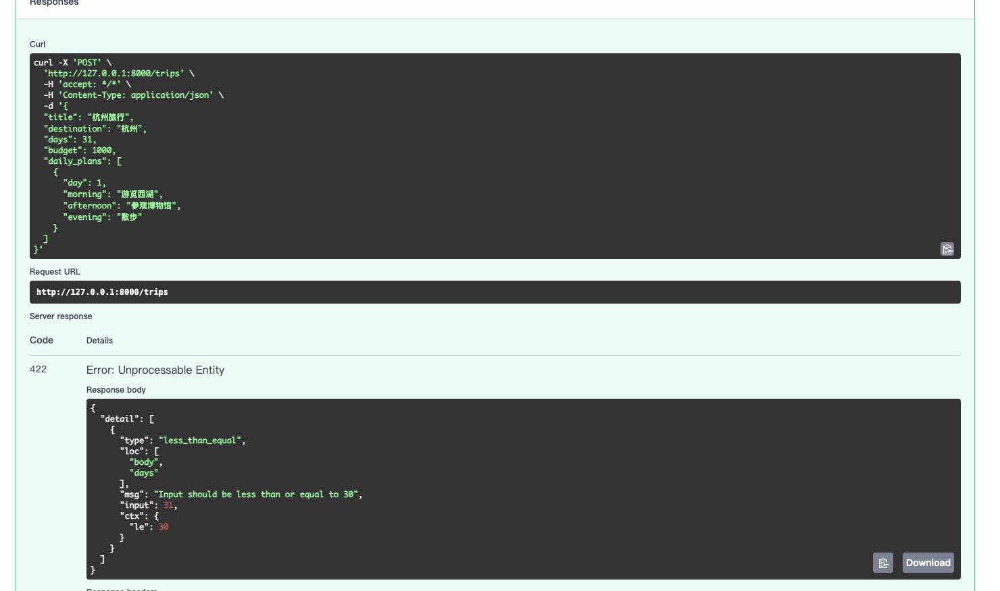
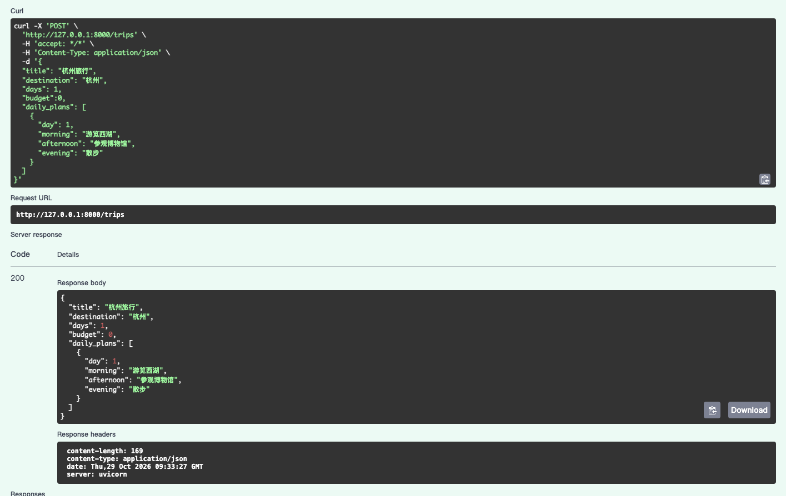

# 输入边界校验

排期日期：2026-10-29。

实际学习日期：2026-10-29。

实际完成日期：2026-10-29。

准备日期：2026-10-28。2026-10-29 开始学习，业务规则已确认，代码已增加天数上限，已验证 days=31 返回 422，以及 days=1、budget=0 返回 200；其余边界已由用户逐项确认验证完成。当天新增知识点集中记录在本篇。

## 当日学习计划及完成情况

目标：明确旅行天数与预算的业务边界，将规则落实到请求模型，并用接口文档检查边界值。每天最多 1.5 小时，超时内容顺延。

| 学习任务 | 预计时长 | 状态 | 完成标准 |
| --- | --- | --- | --- |
| 确认业务规则 | 15 分钟 | 已完成 | 明确最大旅行天数，以及是否允许零预算、零预算表示什么 |
| 调整模型约束 | 25 分钟 | 已完成 | 将确认的规则写入 TripInput，保留已有嵌套与跨字段校验 |
| 验证正常值与边界值 | 35 分钟 | 已完成 | 检查最小值、最大值、越界值、零预算及缺失字段，记录实际响应 |
| 整理知识点与结果 | 15 分钟 | 已完成 | 能解释每条规则的用途；补齐验证表和截图 |

合计预算 90 分钟，包含调试与记录；不是实际用时。

## 学习笔记

### 1. 从现有模型开始

2026-10-29 核对的 `backend/models.py`：

```python
days: int = Field(gt=0, le=30)
budget: float = Field(ge=0, allow_inf_nan=False)
```

当前天数必须大于 0 且不超过 30；预算允许 0，不接受负数及非有限值。两个字段都没有默认值，当前为必填字段。

已经完成的首尾空白清理、拒绝纯空白文本、每日安排数量与天数一致、编号从 1 到最后一天依次排列不再重新讲解。本次在这些约束上补齐输入边界。

当前 POST /trips 只校验并返回输入，没有保存数据。不要把一次正常响应记为创建并保存了行程。

### 2. 先明确规则，再修改代码

用户于 2026-10-29 确认：

| 规则 | 已确认约定 |
| --- | --- |
| 旅行天数 | 必填，1～30 天 |
| 预算为 0 | 允许，表示零预算，不表示不限预算或预算未知 |
| 未填写预算 | 拒绝，不能自动当作 0 |
| 负数及非有限预算 | 拒绝，保留已有约束 |

代码已增加 `le=30`，预算约束保持原样。30 天是本项目约定，不是框架自身的限制。

### 3. 实践步骤

1. 在 `backend/models.py` 中定位 TripInput，根据确认的规则补充天数上限；仅在零预算规则改变时调整预算约束。
2. 保留已有文本、嵌套与跨字段校验，避免添加上限时丢失原有行为。
3. 在已激活虚拟环境的 backend 终端启动服务（已启动则复用）：

   ```bash
   python -m uvicorn api:app --reload
   ```

4. 打开 `http://127.0.0.1:8000/docs`，在 POST /trips 中从合法的一日行程开始，每次只改变一个待测条件。
5. 查看响应状态与错误 detail，结合 loc、msg 定位失败原因；将实际结果填入下表。

本次涉及后端请求模型；下一阶段前端联调需要使用相同规则，当前不提前修改前端。

### 4. 边界验证清单

最大旅行天数已确定为 30。测试合法天数时，每日安排数量与编号也必须匹配，否则会被已有跨字段校验拒绝，无法据此判断上限规则是否正确。

| 场景 | 输入准备 | 预期结果 | 实际结果 |
| --- | --- | --- | --- |
| 最小合法天数 | days=1，安排一条且 day=1，budget=0 | 200，返回校验后的输入 | 已验证：200，响应 days=1，见截图2；与零预算使用同一次请求 |
| 天数为 0 | 只将基准请求的 days 改为 0 | 422，包含天数约束错误 | 已验证：用户确认返回 422，提示天数必须大于 0 |
| 最大合法天数 | days=30，提供 30 条安排，编号 1～30 | 200 | 已验证：用户确认返回 200，包含 30 条安排 |
| 超过最大值 | days=31，提供一条安排 | 422，包含天数上限错误 | 已验证：422，loc 指向 body.days，提示小于或等于 30，见截图1 |
| 零预算 | 合法一日行程，budget=0 | 200 | 已验证：200，响应保留 budget=0，见截图2 |
| 负预算 | 合法一日行程，budget=-1 | 422，包含预算约束错误 | 已验证：用户确认返回 422，错误指向 budget |
| 缺少预算 | 从合法请求中删除 budget 字段 | 422，提示字段缺失 | 已验证：用户确认返回 422，提示字段必填 |
| 缺少天数 | 从合法请求中删除 days 字段 | 422，提示字段缺失 | 已验证：用户确认返回 422，提示字段必填 |

非有限值规则保持现有约束；标准 JSON 不支持 NaN、Infinity 字面值，不将手工发送这些非法 JSON 的解析错误当作模型校验结果。

### 5. 当天知识点与实际结果

- `gt` 表示大于，`ge` 表示大于或等于，`le` 表示小于或等于；`gt=0, le=30` 将整数天数限制在 1～30。
- 允许值为 0 与允许缺少字段是两回事；预算仍必填。
- 本次截图中 `type=less_than_equal` 表示上限约束错误，`loc=["body", "days"]` 指向请求体中的天数字段，`input=31` 是提交值，`ctx.le=30` 是上限。
- days 字段校验失败后，不进入 `mode="after"` 跨字段校验。因此本次虽然只提供一条安排，截图展示的是天数上限错误；验证合法 30 天时仍需准备完整的 30 条安排。

实际结果：用户已启动 FastAPI，接口文档提交 days=31 后返回 422。助手核对截图与模型代码，未重新运行接口。随后提交 days=1、budget=0 和一条 day=1 的安排，返回 200，响应保留天数、零预算和完整安排。该请求同时验证最小合法天数与零预算，用户随后逐项确认负预算、缺少预算、天数为 0、缺少天数均被拒绝，最后确认完整 30 天请求通过。后五项依据用户确认记录，尚无对应截图；助手未重新运行接口。





### 6. 批量准备合法最大天数请求

为避免手工填写 30 条安排，用列表推导式生成请求体，打印后复制到接口文档提交：

```python
import json

trip = {
    "title": "杭州30日游",
    "destination": "杭州",
    "days": 30,
    "budget": 0,
    "daily_plans": [
        {"day": i, "morning": "游览", "afternoon": "参观", "evening": "散步"}
        for i in range(1, 31)
    ]
}
print(json.dumps(trip, ensure_ascii=False, indent=2))
```

`range(1, 31)` 生成 1～30；`json.dumps()` 把 Python 对象转为 JSON 文本，`ensure_ascii=False` 保留可读中文，`indent=2` 方便复制检查。生成 JSON 本身不会发送请求，仍需在 /docs 执行。

预算为 0 的合法请求与删除 budget 字段是不同测试：前者提供有效值，后者违反必填规则；本次两者已分别验证。上限同理，30 天通过、31 天拒绝，两侧都验证才确认边界符合约定。

今日计划的边界清单已全部验证，课程完成；实际用时未计时。下一项为 2026-10-30 的独立响应模型与行程标识，尚未开始。参见[第2周排期](../../排期/第2周排期.md)。
